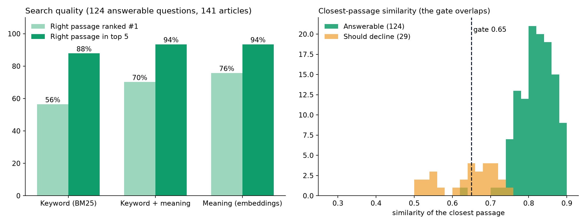
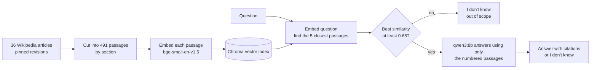

<div align="center">

# Plant Health RAG

**Ask questions about plant diseases and get answers backed by cited sources, or an honest "I don't know".**

[](https://github.com/gangireddymayur/plant-health-rag/actions/workflows/ci.yml)


</div>

---

A retrieval-augmented generation (RAG) system over **36 openly licensed Wikipedia articles** on plant diseases, pests and crop protection. It finds the passages that match a question, has a language model answer **only from those passages**, cites them, and **refuses** when the articles do not contain the answer.

It runs entirely on a laptop: a small embedding model, a local vector database and a local language model (through [Ollama](https://ollama.com)). No data leaves the machine and no API key is needed.

The point of the project is not the demo. It is the **measurement**: a 65-question test set, with search and answer quality scored automatically, and every failure inspected by hand.

## What it looks like

```text
$ python -m plantrag.answer "Which insect carries citrus greening disease, and how does it spread it?"

The citrus greening disease is carried by two species of psyllid insects: the Asian citrus psyllid Diaphorina citri and the African citrus psyllid Trioza erytreae [2]. The disease spreads when these insects feed on the sap of citrus plants, transmitting the bacteria Liberibacter spp. to the plant [4]. The transmission is most efficient during the young larval stage of the psyllid [1].

  [1] Citrus greening disease > Transmission
      https://en.wikipedia.org/wiki/Citrus_greening_disease
  [2] Citrus greening disease > Introduction
      https://en.wikipedia.org/wiki/Citrus_greening_disease
  [4] Diaphorina citri > Damage > Citrus greening disease and other associations
      https://en.wikipedia.org/wiki/Diaphorina_citri

(answered, best similarity 0.821, 9.1 s)

$ python -m plantrag.answer "What exact fungicide dose should I spray on tomato early blight in Telangana?"

I don't know based on the available articles.

(model_refused, best similarity 0.729, 6.2 s)

$ python -m plantrag.answer "Who won the 2018 football World Cup?"

I don't know based on the available articles.

(out_of_scope, best similarity 0.467, 5.8 s)
```

## Results

Measured on a test set I wrote from the articles: **50 answerable and 15 unanswerable questions**. Every third question is a development set used for the few tuning decisions; the other **43 questions were never used for tuning**.

### Answers (qwen3:8b answering, qwen3:14b checking)

| Measure | Test set (43 questions) | All 65 questions |
|---|---|---|
| Answer contains the key facts | **97%** | 94% |
| Wrongly said "I don't know" on an answerable question | 0% | 2% |
| Answers fully supported by the cited passages (LLM checker) | **97%** | 98% |
| Answers that carry a citation | 100% | 100% |
| Unanswerable questions correctly refused | **100%** (10 of 10) | 100% (15 of 15) |
| Unanswerable questions answered anyway (made-up answers) | 0% | 0% |

The 15 unanswerable questions are 7 completely off-topic ones and 8 about plants that the articles cannot answer (for example "What is the price of copper fungicide per litre in Hyderabad?"). Ten were refused by the similarity gate and five by the model itself.

### Search: does the right passage reach the top 5?

<p align="center"></p>

| Search method | Right passage ranked #1 | In the top 5 | MRR |
|---|---|---|---|
| Keyword (BM25) | 42% | 80% | 0.60 |
| Combined (keyword + meaning, rank fusion) | 62% | 90% | 0.74 |
| **Meaning-based (embeddings)** | **70%** | **92%** | **0.80** |

Meaning-based search won on both the development and the test questions, so it is what the answering step uses. Combining it with keyword search did not help here: keyword search is weak on this text, and mixing it in pulled the ranking down. Hybrid search is not automatically better.

### Choosing the "is this about plants?" gate

If even the best-matching passage is not similar enough to the question, the model is not asked at all. On the development questions, real plant questions scored 0.76 or higher and off-topic ones scored below 0.47, so I set the cut-off at **0.65**, a safety margin below the real questions. It blocked all 7 off-topic questions and none of the 50 real ones. Questions that are about plants but not in the articles pass the gate, so for those the model has to refuse by itself, and it did.

## Every failure, inspected

The automatic scores flagged 4 answers. Here is what actually happened, in my reading:

| Question | What the score said | What actually happened |
|---|---|---|
| "How is black rot of apple controlled?" | Wrongly refused | A **real miss, but a safe one.** Search returned only *grape* black rot passages, because the apple article is titled by its scientific name (*Botryosphaeria obtusa*). The model refused instead of answering with grape facts. |
| "What are the main principles of integrated pest management?" | Missing key words | **Supported but incomplete.** Search surfaced the introduction and not the "Principles" section. |
| "Where does the apple scab fungus spend the winter?" | Missing key words | **A grading artifact.** The answer (debris, *pseudothecia*) is right; my keyword list only expected "leaves". |
| "What are the symptoms of common rust on corn?" | Flagged unfaithful | **A checker false alarm.** The answer matches the passage it cites; the checker objected that the passage says *Puccinia sorghi* and not "common rust". |

I kept the headline numbers exactly as measured and did not adjust the test after seeing the failures.

## How it works



- **Chunking** (`chunk.py`): sentences are packed into passages of about 170 words inside one section, with one sentence of overlap. Reference lists are dropped. Each passage keeps its article, section and URL.
- **Search** (`retrieve.py`): keyword (BM25), meaning-based (embeddings in Chroma) and Reciprocal Rank Fusion of both, so the three can be compared.
- **Answering** (`answer.py`): the prompt forbids outside knowledge, requires `[n]` citations, caps the answer at 4 sentences and tells the model to refuse when the passages do not contain the answer. Citations that point to a passage that does not exist are detected.
- **Evaluation** (`evaluate.py`): Hit@k and MRR for search; keyword correctness, citation checks and an LLM checker for faithfulness; refusal behaviour on unanswerable questions.

## Data and models

| | What | Source | Licence |
|---|---|---|---|
| **Documents** | 36 Wikipedia articles (62,563 words): the diseases and pests that my [LeafLens](https://github.com/gangireddymayur/leaflens) app can name, plus background topics such as crop rotation, fungicides and plant disease resistance | The English Wikipedia API, with the exact revision of each article recorded in [`data/corpus_manifest.json`](data/corpus_manifest.json) | CC BY-SA 4.0 |
| **Embeddings** | `BAAI/bge-small-en-v1.5` | Hugging Face | See its model card |
| **Answering model** | `qwen3:8b` | Ollama | See its model card |
| **Checker model** | `qwen3:14b` (evaluation only) | Ollama | See its model card |

The article text is **not stored in this repository**. `python -m plantrag.fetch` downloads it, so the corpus can be rebuilt exactly from the pinned revisions, and every answer links back to its source article.

<details>
<summary>The 36 articles</summary>

[Apple scab](https://en.wikipedia.org/wiki/Apple_scab), [Botryosphaeria obtusa](https://en.wikipedia.org/wiki/Botryosphaeria_obtusa), [Gymnosporangium juniperi-virginianae](https://en.wikipedia.org/wiki/Gymnosporangium_juniperi-virginianae), [Erysiphaceae](https://en.wikipedia.org/wiki/Erysiphaceae), [Corn grey leaf spot](https://en.wikipedia.org/wiki/Corn_grey_leaf_spot), [Puccinia sorghi](https://en.wikipedia.org/wiki/Puccinia_sorghi), [Northern corn leaf blight](https://en.wikipedia.org/wiki/Northern_corn_leaf_blight), [Black rot (grape disease)](https://en.wikipedia.org/wiki/Black_rot_(grape_disease)), [Esca (grape disease)](https://en.wikipedia.org/wiki/Esca_(grape_disease)), [Citrus greening disease](https://en.wikipedia.org/wiki/Citrus_greening_disease), [Diaphorina citri](https://en.wikipedia.org/wiki/Diaphorina_citri), [Xanthomonas arboricola pv. pruni](https://en.wikipedia.org/wiki/Xanthomonas_arboricola_pv._pruni), [Bacterial leaf spot of peppers and tomato](https://en.wikipedia.org/wiki/Bacterial_leaf_spot_of_peppers_and_tomato), [Alternaria solani](https://en.wikipedia.org/wiki/Alternaria_solani), [Phytophthora infestans](https://en.wikipedia.org/wiki/Phytophthora_infestans), [Diplocarpon earlianum](https://en.wikipedia.org/wiki/Diplocarpon_earlianum), [Tomato leaf mold](https://en.wikipedia.org/wiki/Tomato_leaf_mold), [Septoria lycopersici](https://en.wikipedia.org/wiki/Septoria_lycopersici), [Tetranychus urticae](https://en.wikipedia.org/wiki/Tetranychus_urticae), [Corynespora cassiicola](https://en.wikipedia.org/wiki/Corynespora_cassiicola), [Tomato yellow leaf curl virus](https://en.wikipedia.org/wiki/Tomato_yellow_leaf_curl_virus), [Tomato mosaic virus](https://en.wikipedia.org/wiki/Tomato_mosaic_virus), [Plant pathology](https://en.wikipedia.org/wiki/Plant_pathology), [Plant disease](https://en.wikipedia.org/wiki/Plant_disease), [Plant disease resistance](https://en.wikipedia.org/wiki/Plant_disease_resistance), [Plant disease epidemiology](https://en.wikipedia.org/wiki/Plant_disease_epidemiology), [Fungicide](https://en.wikipedia.org/wiki/Fungicide), [Crop rotation](https://en.wikipedia.org/wiki/Crop_rotation), [Integrated pest management](https://en.wikipedia.org/wiki/Integrated_pest_management), [Plant virus](https://en.wikipedia.org/wiki/Plant_virus), [Whitefly](https://en.wikipedia.org/wiki/Whitefly), [Mulch](https://en.wikipedia.org/wiki/Mulch), [Leaf spot](https://en.wikipedia.org/wiki/Leaf_spot), [Blight](https://en.wikipedia.org/wiki/Blight), [Rust (fungus)](https://en.wikipedia.org/wiki/Rust_(fungus)), [Oomycete](https://en.wikipedia.org/wiki/Oomycete)

</details>

## Run it

Needs Python 3.11 or 3.12 and [Ollama](https://ollama.com) (about 5 GB for the 8B model).

```bash
pip install uv
uv venv --python 3.12 .venv
uv pip install --python .venv/bin/python -r requirements.txt
ollama pull qwen3:8b            # answers (also pull qwen3:14b to run the full evaluation)
export PYTHONPATH=src

.venv/bin/python -m plantrag.fetch      # download the articles (about 1 to 2 minutes)
.venv/bin/python -m plantrag.index      # chunk, embed and index them
.venv/bin/python -m plantrag.answer "How is tomato yellow leaf curl virus transmitted?"

.venv/bin/python -m plantrag.evaluate --retrieval   # search comparison (about 1 minute)
.venv/bin/python -m plantrag.evaluate --answers     # full answer test (about 10 minutes)
```

### Web page

A small local chat page that calls the same code as the command line (answers, citations and refusals are identical):

```bash
uv pip install --python .venv/bin/python -r requirements-app.txt
PYTHONPATH=src .venv/bin/python -m plantrag.app      # opens at http://127.0.0.1:7860
```

It needs Ollama running locally, so it is not deployable to serverless hosts such as Vercel. The first question takes a few extra seconds while the embedding model loads.

The test questions are in [`eval/questions.json`](eval/questions.json), with the evidence rules, the dev/test split and the per-question results in `eval/`.

## Limitations

- **The test is small and I wrote it.** 65 questions from the same articles the system searches, so results are likely optimistic and carry roughly a 5-point margin. It has not been tried on typos, slang, other languages or real users.
- **Grading is crude.** Keyword matching misses some correct wordings, and the faithfulness checker is an LLM from the same family as the answerer. I read the flagged cases, not every answer.
- **Common names versus scientific names.** The apple black rot miss above shows the main weakness. Query rewriting or alias lists would be the natural fix.
- **Wikipedia only.** One article ("Esca") is a stub, so questions about it cannot be answered. Wikipedia is general background, not regional agronomic advice, and nothing here replaces a local agricultural officer.
- **Speed.** About 5 to 10 seconds per answer for the 8B model on an Apple M5 Pro laptop.

## Tests and CI

```bash
PYTHONPATH=src python -m unittest discover -s tests -v
```

28 unit tests cover chunking, rank fusion, prompt building, citation parsing and the evaluation metrics. They need no models, and CI runs them on every push.

---

<div align="center">

**Designed and developed by [Mayur Gangireddy](https://github.com/gangireddymayur)**

Code © 2026 Mayur Gangireddy. All rights reserved. Article text is © Wikipedia contributors, CC BY-SA 4.0.

</div>
