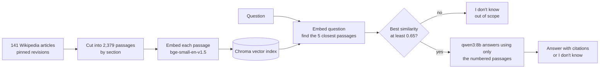

<div align="center">

# Plant Health RAG

**Ask questions about plant diseases and get answers backed by cited sources, or an honest "I don't know".**

[](https://github.com/gangireddymayur/plant-health-rag/actions/workflows/ci.yml)


</div>

---

A retrieval-augmented generation (RAG) system over **141 openly licensed Wikipedia articles** on plant diseases, pests and crop protection, with a focus on crops and pests of **India and the United States** (rice, wheat, cotton, sugarcane, banana, coffee, tea, maize, soybean and more). It finds the passages that match a question, has a language model answer **only from those passages**, cites them, and **refuses** when the articles do not contain the answer.

It runs entirely on a laptop: a small embedding model, a local vector database and a local language model (through [Ollama](https://ollama.com)). No data leaves the machine and no API key is needed.

The point of the project is not the demo. It is the **measurement**: a 153-question test set, with search and answer quality scored automatically, and every failure inspected by hand.

## What it looks like

```text
$ python -m plantrag.answer "Which insect carries citrus greening disease, and how does it spread it?"

The citrus greening disease is carried by two species of psyllid insects: the Asian citrus psyllid Diaphorina citri and the African citrus psyllid Trioza erytreae [2]. The disease spreads when these insects feed on the sap of citrus plants, transmitting the bacteria Liberibacter spp. to the plant [4]. The transmission is most efficient during the young larval stage of the psyllid [1].

  [1] Citrus greening disease > Transmission
      https://en.wikipedia.org/wiki/Citrus_greening_disease
  [2] Citrus greening disease > Introduction
      https://en.wikipedia.org/wiki/Citrus_greening_disease
  [4] Diaphorina citri > Damage > Citrus greening disease and other associations
      https://en.wikipedia.org/wiki/Diaphorina_citri

(answered, best similarity 0.821, 9.1 s)

$ python -m plantrag.answer "What exact fungicide dose should I spray on tomato early blight in Telangana?"

I don't know based on the available articles.

(model_refused, best similarity 0.729, 6.2 s)

$ python -m plantrag.answer "Who won the 2018 football World Cup?"

I don't know based on the available articles.

(out_of_scope, best similarity 0.467, 5.8 s)
```

## Results

Measured on a test set I wrote from the articles: **124 answerable and 29 unanswerable questions**. Every third question is a development set; the other **102 questions were never used for any tuning**. (The first 65 questions are from the original 36-article version, unchanged; 88 were added when the corpus grew to 141 articles. The old results are in [`eval/archive_36_articles/`](eval/archive_36_articles).)

### Answers (qwen3:8b answering, qwen3:14b checking)

| Measure | Test set (102 questions) | All 153 questions |
|---|---|---|
| Answer contains the key facts | **94%** | 92% |
| Wrongly said "I don't know" on an answerable question | 4% | 3% |
| Answers fully supported by the cited passages (LLM checker) | 94% | 95% |
| Answers that carry a citation | 100% | 100% |
| Unanswerable questions correctly refused | **95%** (19 of 20) | 97% (28 of 29) |
| Unanswerable questions answered anyway | 5% (1 of 20) | 3% (1 of 29) |

The 29 unanswerable questions are 10 off-topic ones and 19 about farming topics the articles cannot answer (for example "What is the minimum support price of paddy this year?"). Fourteen were stopped by the similarity gate and fourteen refused by the model itself.

### Search: does the right passage reach the top 5?

<p align="center"></p>

| Search method | Right passage ranked #1 | In the top 5 | MRR |
|---|---|---|---|
| Keyword (BM25) | 56% | 88% | 0.71 |
| Combined (keyword + meaning, rank fusion) | 70% | 94% | 0.80 |
| **Meaning-based (embeddings)** | **76%** | **94%** | **0.84** |

Meaning-based search is best at putting the right passage first (76% vs 70%) and has the best MRR, so it is what the answering step uses. With the larger corpus, combining it with keyword search now ties it for the top 5, but still ranks the right passage first less often. Tripling the corpus from 36 to 141 articles barely moved the original 65 questions (top-5 hit rate 92% to 90%, one question).

### The "is this about plants?" gate

If even the best-matching passage is not similar enough to the question, the model is not asked at all. With 36 articles this cut-off (**0.65**) separated real and off-topic questions cleanly. **With 141 articles it no longer does:** the best off-topic question scored 0.668 and the lowest real question 0.635. The gate still blocked 14 of 29 unanswerable questions, but it also blocked one real question ("What is Ug99?", similarity 0.635), and the model's own refusal now does a lot of the work. I did not re-tune the cut-off, so these numbers are for the settings chosen on the 36-article version.

## Every failure, inspected

The automatic scores flagged 10 answerable questions as not correct, a few more as not fully supported, and one unanswerable question as answered. Here is what actually happened, in my reading:

| Question | What the score said | What actually happened |
|---|---|---|
| "What are the symptoms of common rust on corn?" and "How is black rot of apple controlled?" | Wrongly refused | **Real misses, but safe ones.** Search returns passages under scientific names and the model refused instead of guessing. (Both also missed in the 36-article version.) |
| "Which crop do western corn rootworm larvae feed on?" | Wrongly refused | **A real miss, and a safe one.** Similarity 0.75, so it passed the gate, but the model declined. |
| "What is Ug99?" | Wrongly refused | **A real miss caused by the gate:** the best passage scored 0.635, just under the 0.65 cut-off. |
| "How is rice tungro disease spread?" | Not correct, unsupported | **A real error.** The answer says coinfection by two viruses and never names the leafhopper vector; search returned the wrong passage first. |
| "What is stripe rust of wheat also called?" | Missing key words | **Weak answer.** It gave the pathogen's scientific name and not "yellow rust". |
| "Which rice disease does Xanthomonas oryzae cause?" | Missing key words | **Ambiguous question.** The model answered bacterial leaf streak (a real disease of that species); my key words expected "blight". |
| "What are the main principles of integrated pest management?" | Missing key words | **Supported but incomplete.** Search surfaced a general passage and not the principles. |
| "Where does the apple scab fungus spend the winter?" | Missing key words | **A grading artifact.** The answer (debris, *pseudothecia*) is right; my key words expected "leaves". |
| "How is cotton leaf curl virus spread?" | Missing key words | **A grading artifact.** The answer says "white flies" with a space; my key words expected "whitefly". |
| "When should I sow cotton in Gujarat?" (unanswerable) | Answered anyway | **A real failure.** The articles never mention Gujarat; the model answered with the general kharif season. This is the one unsupported answer. |

Three of the ten "not correct" answers are grading artifacts, so true accuracy is a little higher than the strict automatic number. I kept the headline numbers exactly as measured and did not adjust the test after seeing the failures. A few other answers were flagged "not fully supported" by the checker; the checker is a model from the same family as the answerer, so I treat that column as indicative only.

## How it works



- **Chunking** (`chunk.py`): sentences are packed into passages of about 170 words inside one section, with one sentence of overlap. Reference lists are dropped. Each passage keeps its article, section and URL.
- **Search** (`retrieve.py`): keyword (BM25), meaning-based (embeddings in Chroma) and Reciprocal Rank Fusion of both, so the three can be compared.
- **Answering** (`answer.py`): the prompt forbids outside knowledge, requires `[n]` citations, caps the answer at 4 sentences and tells the model to refuse when the passages do not contain the answer. Citations that point to a passage that does not exist are detected.
- **Evaluation** (`evaluate.py`): Hit@k and MRR for search; keyword correctness, citation checks and an LLM checker for faithfulness; refusal behaviour on unanswerable questions.

## Data and models

| | What | Source | Licence |
|---|---|---|---|
| **Documents** | 141 Wikipedia articles (308,313 words): the diseases and pests that my [LeafLens](https://github.com/gangireddymayur/leaflens) app can name, major crop diseases and pests of India and the US (rice, wheat, cotton, sugarcane, banana, coffee, tea, maize, soybean), biological and chemical control, and background topics such as crop rotation and plant disease resistance | The English Wikipedia API, with the exact revision of each article recorded in [`data/corpus_manifest.json`](data/corpus_manifest.json) | CC BY-SA 4.0 |
| **Embeddings** | `BAAI/bge-small-en-v1.5` | Hugging Face | See its model card |
| **Answering model** | `qwen3:8b` | Ollama | See its model card |
| **Checker model** | `qwen3:14b` (evaluation only) | Ollama | See its model card |

The article text is **not stored in this repository**. `python -m plantrag.fetch` downloads it, so the corpus can be rebuilt exactly from the pinned revisions, and every answer links back to its source article.

<details>
<summary>The 141 articles</summary>

[Apple scab](https://en.wikipedia.org/wiki/Apple_scab), [Botryosphaeria obtusa](https://en.wikipedia.org/wiki/Botryosphaeria_obtusa), [Gymnosporangium juniperi-virginianae](https://en.wikipedia.org/wiki/Gymnosporangium_juniperi-virginianae), [Erysiphaceae](https://en.wikipedia.org/wiki/Erysiphaceae), [Corn grey leaf spot](https://en.wikipedia.org/wiki/Corn_grey_leaf_spot), [Puccinia sorghi](https://en.wikipedia.org/wiki/Puccinia_sorghi), [Northern corn leaf blight](https://en.wikipedia.org/wiki/Northern_corn_leaf_blight), [Black rot (grape disease)](https://en.wikipedia.org/wiki/Black_rot_(grape_disease)), [Esca (grape disease)](https://en.wikipedia.org/wiki/Esca_(grape_disease)), [Citrus greening disease](https://en.wikipedia.org/wiki/Citrus_greening_disease), [Diaphorina citri](https://en.wikipedia.org/wiki/Diaphorina_citri), [Xanthomonas arboricola pv. pruni](https://en.wikipedia.org/wiki/Xanthomonas_arboricola_pv._pruni), [Bacterial leaf spot of peppers and tomato](https://en.wikipedia.org/wiki/Bacterial_leaf_spot_of_peppers_and_tomato), [Alternaria solani](https://en.wikipedia.org/wiki/Alternaria_solani), [Phytophthora infestans](https://en.wikipedia.org/wiki/Phytophthora_infestans), [Diplocarpon earlianum](https://en.wikipedia.org/wiki/Diplocarpon_earlianum), [Tomato leaf mold](https://en.wikipedia.org/wiki/Tomato_leaf_mold), [Septoria lycopersici](https://en.wikipedia.org/wiki/Septoria_lycopersici), [Tetranychus urticae](https://en.wikipedia.org/wiki/Tetranychus_urticae), [Corynespora cassiicola](https://en.wikipedia.org/wiki/Corynespora_cassiicola), [Tomato yellow leaf curl virus](https://en.wikipedia.org/wiki/Tomato_yellow_leaf_curl_virus), [Tomato mosaic virus](https://en.wikipedia.org/wiki/Tomato_mosaic_virus), [Plant pathology](https://en.wikipedia.org/wiki/Plant_pathology), [Plant disease](https://en.wikipedia.org/wiki/Plant_disease), [Plant disease resistance](https://en.wikipedia.org/wiki/Plant_disease_resistance), [Plant disease epidemiology](https://en.wikipedia.org/wiki/Plant_disease_epidemiology), [Fungicide](https://en.wikipedia.org/wiki/Fungicide), [Crop rotation](https://en.wikipedia.org/wiki/Crop_rotation), [Integrated pest management](https://en.wikipedia.org/wiki/Integrated_pest_management), [Plant virus](https://en.wikipedia.org/wiki/Plant_virus), [Whitefly](https://en.wikipedia.org/wiki/Whitefly), [Mulch](https://en.wikipedia.org/wiki/Mulch), [Leaf spot](https://en.wikipedia.org/wiki/Leaf_spot), [Blight](https://en.wikipedia.org/wiki/Blight), [Rust (fungus)](https://en.wikipedia.org/wiki/Rust_(fungus)), [Oomycete](https://en.wikipedia.org/wiki/Oomycete), [Magnaporthe grisea](https://en.wikipedia.org/wiki/Magnaporthe_grisea), [Xanthomonas oryzae](https://en.wikipedia.org/wiki/Xanthomonas_oryzae), [Rhizoctonia solani](https://en.wikipedia.org/wiki/Rhizoctonia_solani), [Cochliobolus miyabeanus](https://en.wikipedia.org/wiki/Cochliobolus_miyabeanus), [Tungrovirus](https://en.wikipedia.org/wiki/Tungrovirus), [Brown planthopper](https://en.wikipedia.org/wiki/Brown_planthopper), [Scirpophaga incertulas](https://en.wikipedia.org/wiki/Scirpophaga_incertulas), [Stem rust](https://en.wikipedia.org/wiki/Stem_rust), [Puccinia striiformis var. striiformis](https://en.wikipedia.org/wiki/Puccinia_striiformis_var._striiformis), [Wheat leaf rust](https://en.wikipedia.org/wiki/Wheat_leaf_rust), [Karnal bunt](https://en.wikipedia.org/wiki/Karnal_bunt), [Fusarium ear blight](https://en.wikipedia.org/wiki/Fusarium_ear_blight), [Loose smut](https://en.wikipedia.org/wiki/Loose_smut), [Ergot](https://en.wikipedia.org/wiki/Ergot), [Wheat](https://en.wikipedia.org/wiki/Wheat), [Pink bollworm](https://en.wikipedia.org/wiki/Pink_bollworm), [Helicoverpa armigera](https://en.wikipedia.org/wiki/Helicoverpa_armigera), [Cotton leaf curl virus](https://en.wikipedia.org/wiki/Cotton_leaf_curl_virus), [Verticillium wilt](https://en.wikipedia.org/wiki/Verticillium_wilt), [Fusarium wilt](https://en.wikipedia.org/wiki/Fusarium_wilt), [Boll weevil](https://en.wikipedia.org/wiki/Boll_weevil), [Cotton](https://en.wikipedia.org/wiki/Cotton), [Canker](https://en.wikipedia.org/wiki/Canker), [Colletotrichum](https://en.wikipedia.org/wiki/Colletotrichum), [Peanut](https://en.wikipedia.org/wiki/Peanut), [Cercospora arachidicola](https://en.wikipedia.org/wiki/Cercospora_arachidicola), [Aspergillus flavus](https://en.wikipedia.org/wiki/Aspergillus_flavus), [Aflatoxin](https://en.wikipedia.org/wiki/Aflatoxin), [Glomerella tucumanensis](https://en.wikipedia.org/wiki/Glomerella_tucumanensis), [Sugarcane smut](https://en.wikipedia.org/wiki/Sugarcane_smut), [Sugarcane](https://en.wikipedia.org/wiki/Sugarcane), [Rice](https://en.wikipedia.org/wiki/Rice), [Maize](https://en.wikipedia.org/wiki/Maize), [Panama disease](https://en.wikipedia.org/wiki/Panama_disease), [Black sigatoka](https://en.wikipedia.org/wiki/Black_sigatoka), [Banana bunchy top virus](https://en.wikipedia.org/wiki/Banana_bunchy_top_virus), [Banana streak virus](https://en.wikipedia.org/wiki/Banana_streak_virus), [Oryctes rhinoceros](https://en.wikipedia.org/wiki/Oryctes_rhinoceros), [Rhynchophorus ferrugineus](https://en.wikipedia.org/wiki/Rhynchophorus_ferrugineus), [Lethal yellowing](https://en.wikipedia.org/wiki/Lethal_yellowing), [Hemileia vastatrix](https://en.wikipedia.org/wiki/Hemileia_vastatrix), [Exobasidium vexans](https://en.wikipedia.org/wiki/Exobasidium_vexans), [Hypothenemus hampei](https://en.wikipedia.org/wiki/Hypothenemus_hampei), [Potato virus Y](https://en.wikipedia.org/wiki/Potato_virus_Y), [Colorado potato beetle](https://en.wikipedia.org/wiki/Colorado_potato_beetle), [Ralstonia solanacearum](https://en.wikipedia.org/wiki/Ralstonia_solanacearum), [Bacterial wilt](https://en.wikipedia.org/wiki/Bacterial_wilt), [Fusarium oxysporum](https://en.wikipedia.org/wiki/Fusarium_oxysporum), [Calcium deficiency (plant)](https://en.wikipedia.org/wiki/Calcium_deficiency_(plant)), [Tomato spotted wilt virus](https://en.wikipedia.org/wiki/Tomato_spotted_wilt_virus), [Phakopsora pachyrhizi](https://en.wikipedia.org/wiki/Phakopsora_pachyrhizi), [Soybean cyst nematode](https://en.wikipedia.org/wiki/Soybean_cyst_nematode), [Soybean aphid](https://en.wikipedia.org/wiki/Soybean_aphid), [Corn smut](https://en.wikipedia.org/wiki/Corn_smut), [Diabrotica virgifera](https://en.wikipedia.org/wiki/Diabrotica_virgifera), [European corn borer](https://en.wikipedia.org/wiki/European_corn_borer), [Southern corn leaf blight](https://en.wikipedia.org/wiki/Southern_corn_leaf_blight), [Helicoverpa zea](https://en.wikipedia.org/wiki/Helicoverpa_zea), [Fall armyworm](https://en.wikipedia.org/wiki/Fall_armyworm), [Desert locust](https://en.wikipedia.org/wiki/Desert_locust), [Aphid](https://en.wikipedia.org/wiki/Aphid), [Thrips](https://en.wikipedia.org/wiki/Thrips), [Leafhopper](https://en.wikipedia.org/wiki/Leafhopper), [Mealybug](https://en.wikipedia.org/wiki/Mealybug), [Root-knot nematode](https://en.wikipedia.org/wiki/Root-knot_nematode), [Cutworm](https://en.wikipedia.org/wiki/Cutworm), [Diamondback moth](https://en.wikipedia.org/wiki/Diamondback_moth), [Tuta absoluta](https://en.wikipedia.org/wiki/Tuta_absoluta), [Spotted lanternfly](https://en.wikipedia.org/wiki/Spotted_lanternfly), [Emerald ash borer](https://en.wikipedia.org/wiki/Emerald_ash_borer), [Japanese beetle](https://en.wikipedia.org/wiki/Japanese_beetle), [Brown marmorated stink bug](https://en.wikipedia.org/wiki/Brown_marmorated_stink_bug), [Armyworm](https://en.wikipedia.org/wiki/Armyworm), [Damping off](https://en.wikipedia.org/wiki/Damping_off), [Root rot](https://en.wikipedia.org/wiki/Root_rot), [Fusarium](https://en.wikipedia.org/wiki/Fusarium), [Wilt disease](https://en.wikipedia.org/wiki/Wilt_disease), [Downy mildew](https://en.wikipedia.org/wiki/Downy_mildew), [Sooty mold](https://en.wikipedia.org/wiki/Sooty_mold), [Agrobacterium tumefaciens](https://en.wikipedia.org/wiki/Agrobacterium_tumefaciens), [Fire blight](https://en.wikipedia.org/wiki/Fire_blight), [Citrus canker](https://en.wikipedia.org/wiki/Citrus_canker), [Phytophthora ramorum](https://en.wikipedia.org/wiki/Phytophthora_ramorum), [Chestnut blight](https://en.wikipedia.org/wiki/Chestnut_blight), [Taphrina deformans](https://en.wikipedia.org/wiki/Taphrina_deformans), [Monilinia fructicola](https://en.wikipedia.org/wiki/Monilinia_fructicola), [Biological pest control](https://en.wikipedia.org/wiki/Biological_pest_control), [Pesticide](https://en.wikipedia.org/wiki/Pesticide), [Neem oil](https://en.wikipedia.org/wiki/Neem_oil), [Bacillus thuringiensis](https://en.wikipedia.org/wiki/Bacillus_thuringiensis), [Trichoderma](https://en.wikipedia.org/wiki/Trichoderma), [Pesticide resistance](https://en.wikipedia.org/wiki/Pesticide_resistance), [Organic farming](https://en.wikipedia.org/wiki/Organic_farming), [Soil solarization](https://en.wikipedia.org/wiki/Soil_solarization), [Intercropping](https://en.wikipedia.org/wiki/Intercropping), [Agriculture in India](https://en.wikipedia.org/wiki/Agriculture_in_India), [Green Revolution in India](https://en.wikipedia.org/wiki/Green_Revolution_in_India), [Indian Council of Agricultural Research](https://en.wikipedia.org/wiki/Indian_Council_of_Agricultural_Research), [Kharif crop](https://en.wikipedia.org/wiki/Kharif_crop), [Rabi crop](https://en.wikipedia.org/wiki/Rabi_crop), [Agriculture in the United States](https://en.wikipedia.org/wiki/Agriculture_in_the_United_States), [Mango](https://en.wikipedia.org/wiki/Mango), [Chili pepper](https://en.wikipedia.org/wiki/Chili_pepper), [Pigeon pea](https://en.wikipedia.org/wiki/Pigeon_pea), [Chickpea](https://en.wikipedia.org/wiki/Chickpea)

</details>

## Run it

Needs Python 3.11 or 3.12 and [Ollama](https://ollama.com) (about 5 GB for the 8B model).

```bash
pip install uv
uv venv --python 3.12 .venv
uv pip install --python .venv/bin/python -r requirements.txt
ollama pull qwen3:8b            # answers (also pull qwen3:14b to run the full evaluation)
export PYTHONPATH=src

.venv/bin/python -m plantrag.fetch      # download the articles (about 1 to 2 minutes)
.venv/bin/python -m plantrag.index      # chunk, embed and index them
.venv/bin/python -m plantrag.answer "How is tomato yellow leaf curl virus transmitted?"

.venv/bin/python -m plantrag.evaluate --retrieval   # search comparison (about 1 minute)
.venv/bin/python -m plantrag.evaluate --answers     # full answer test (about 10 minutes)
```

### Chat page

A local chat interface that calls the same code as the command line (answers, citations and refusals are identical):

<p align="center">
  
</p>

- Chat history in a sidebar (saved in your browser only), new chat and delete
- **Enter** to send, **Shift+Enter** for a new line
- Model picker: lists the chat models installed in your Ollama
- Voice input (mic button) using the browser's speech recognition
- Every answer shows its status, match strength, time and model, with numbered citations and links to the source article
- Greetings and chit-chat ("hi", "thanks", "what can you do?") get a fixed friendly reply with no language model involved, so nothing can be made up; factual questions still go through the cited path, and unrelated ones are declined
- Each question is answered on its own; the assistant does not remember earlier turns

```bash
uv pip install --python .venv/bin/python -r requirements-app.txt
PYTHONPATH=src .venv/bin/python -m plantrag.app      # opens at http://127.0.0.1:7860
```

It needs Ollama running locally, so it cannot be deployed to serverless hosts such as Vercel. The first question takes a few extra seconds while the embedding model loads. Voice input uses the browser's built-in speech recognition; in Chrome that sends the audio to Google, so it is the one optional part that is not fully local. Typing keeps everything on your machine.

The test questions are in [`eval/questions.json`](eval/questions.json), with the evidence rules, the dev/test split and the per-question results in `eval/`.

## Limitations

- **The test is small and I wrote it.** 153 questions from the same articles the system searches, so results are likely optimistic and carry roughly a 5-point margin. It has not been tried on typos, slang, other languages or real users.
- **Grading is crude.** Keyword matching misses some correct wordings, and the faithfulness checker is an LLM from the same family as the answerer. I read the flagged cases, not every answer.
- **Common names versus scientific names.** The apple black rot miss above shows the main weakness. Query rewriting or alias lists would be the natural fix.
- **Wikipedia only.** One article ("Esca") is a stub, so questions about it cannot be answered. Wikipedia is general background, not regional agronomic advice, and nothing here replaces a local agricultural officer.
- **Speed.** About 5 to 10 seconds per answer for the 8B model on an Apple M5 Pro laptop.

## Tests and CI

```bash
PYTHONPATH=src python -m unittest discover -s tests -v
```

28 unit tests cover chunking, rank fusion, prompt building, citation parsing and the evaluation metrics. They need no models, and CI runs them on every push. 15 more cover the chat page's small-talk routing and run when FastAPI is installed (`requirements-app.txt`).

---

<div align="center">

**Designed and developed by [Mayur Gangireddy](https://github.com/gangireddymayur)**

Code © 2026 Mayur Gangireddy. All rights reserved. Article text is © Wikipedia contributors, CC BY-SA 4.0.

</div>
